# Metal Slug Font Examples

## Font 1
- **Blue:** 
  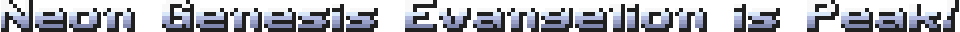

- **Orange:** 
  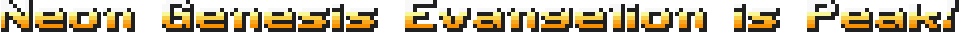

- **Gold:** 
  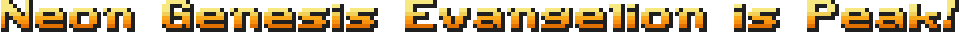

## Font 2
- **Blue:** 
  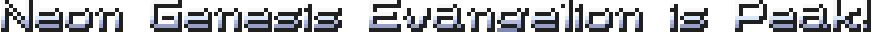

- **Orange:** 
  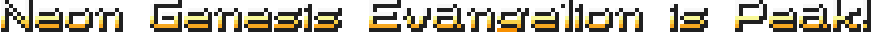

- **Gold:** 
  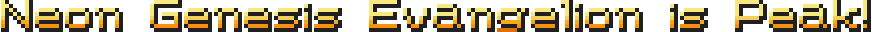

## Font 3
- **Blue:** 
  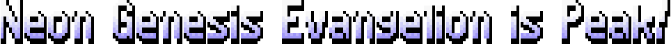

- **Orange:** 
  

## Font 4
- **Blue:** 
  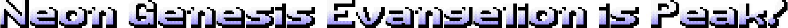

- **Gold:** 
  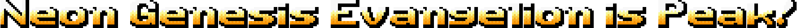

- **Yellow:** 
  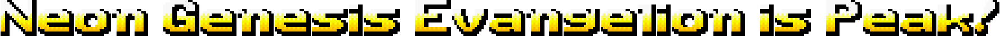

## Font 5
- **Orange:** 
  

## Advanced Mode

Enable **Advanced Mode** under Options, and the Generate button becomes
**Generate & Edit**. Instead of saving directly, a per-character editor
opens with the whole canvas laid out for you, Aseprite-style.

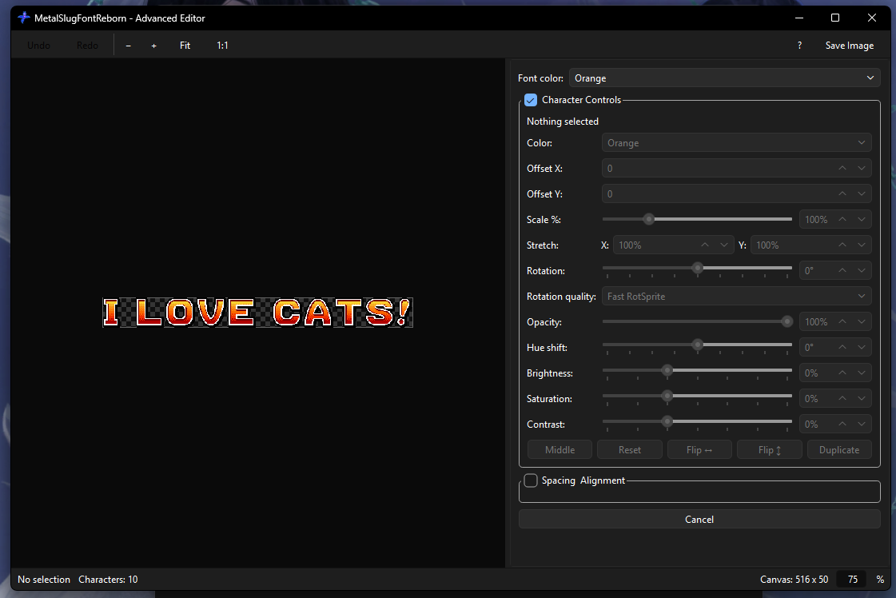

### Character controls

Every character is a sprite you can transform and restyle from the
Character Controls panel:

- **Move** - drag on canvas or nudge with the arrow keys, with X/Y
  offset boxes for exact placement.
- **Scale** - 10% to 400%, uniform, via slider or spin box.
- **Rotate** - ±180° in 45° steps on a slider, with a rotation
  quality selector (Fast RotSprite, full RotSprite or Nearest).
- **Stretch** - independent X/Y percentage for squashing or widening
  a character without touching the others.
- **Flip** - horizontal and vertical flip toggles.
- **Opacity** - 0 to 100%.
- **Color** - hue shift (±180°), saturation, brightness and contrast
  sliders, plus a per-character color variant picker (the same Blue,
  Orange, Gold, Yellow variants as the main window, where the font
  provides them).
- **Replace** - double-click a character (or use the panel) to swap it
  for any text: one letter or a whole phrase like `I LOVE CATS`.
- **Reset** - restore selected characters to their original position,
  scale, rotation and appearance.

### Transform handles

With a character selected, an Aseprite-style box wraps it:

- Corner and edge handles resize the character, corners rotate it when
  you grab the outer ring, and Shift constrains scaling to the
  original aspect ratio.
- The tilted box follows a rotated character exactly, so handles stay
  where they look like they should be.

### Selection

- Click to select, Ctrl+click to add or remove, or drag on empty
  space for a marquee selection (Shift adds, Alt subtracts).
- Multi-selections move, scale and stretch as a group, each character
  keeping its own relative size.
- `Ctrl+D` duplicates the selection with every transform and color
  setting copied.

### Snapping

While snapping is enabled, dragged characters click onto other
characters' edges, centres and baselines with magenta guide lines,
falling back to the grid size from the settings. Hold Alt or Ctrl to
suspend snapping mid-drag.

### Canvas, zoom and pan

- **Canvas size** - set width and height directly (applied live), or
  use Crop to Content to tight-fit the canvas around your characters.
- **Spacing & alignment** - letter spacing, line spacing, vertical
  alignment within lines and line alignment on the canvas.
- **Zoom** - Aseprite's preset zoom ladder from 1/64x to 64x: mouse
  wheel to step, `Ctrl+1` for 100%, Fit to fill the view. Space+drag
  or middle-drag pans.
- The document sits on a Photoshop-style pasteboard with a live
  transparency checkerboard that scales with zoom.

### Layer order

Right-click a character for Duplicate, Reset Scale, Reset Rotation,
90° rotate, Bring to Front, Send to Back and Delete.

### Undo/redo and export

- `Ctrl+Z` / `Ctrl+Y` (or `Ctrl+Shift+Z`) undo and redo every editing
  action, up to 30 steps.
- `Ctrl+S` or Save Image exports the composition: what you see on the
  canvas is exactly what gets exported, using the main window's
  compression and scale settings. Closing with unsaved edits asks for
  confirmation first.
