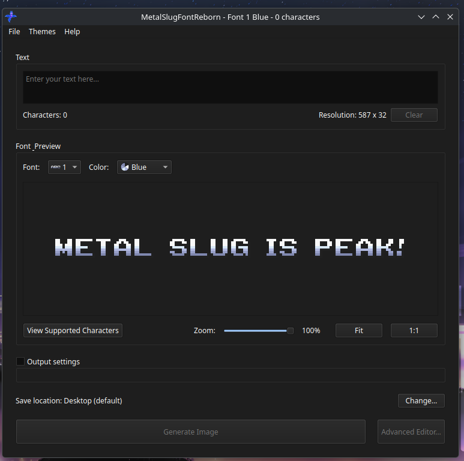

# **Linux:**

**Requirements:** the system X11 stack: `libxkbcommon` and the xcb utility libraries (icccm, keysyms, xinerama, render-util, image, shape, randr, cursor), plus OpenGL/EGL. Every desktop install has these; on Debian/Ubuntu: `sudo apt install libxkbcommon-x11-0 libxcb-cursor0 libxcb-icccm4 libxcb-keysyms1 libxcb-xinerama0 libxcb-render-util0 libxcb-image0 libxcb-shape0 libxcb-randr0 libegl1`.

1. Get the latest release of [MetalSlugFontReborn](https://github.com/Mitra-88/MetalSlugFontReborn/releases/latest).

   

**Extract and Run MetalSlugFontReborn:**
   - Locate and extract `MetalSlugFontReborn-v3.x.x-Linux-x64.zip`.
   - Go to the `MetalSlugFontReborn` folder.
   - Run `MetalSlugFontReborn`.

3. **Select a Font:**
   - Upon opening MetalSlugFontReborn, choose your desired font and color, you can them [preview](EXAMPLES.md) here.

 

4. **Input Your Text:**
   - Enter the text you want to convert to the metal slug font.

5. **Generate the Image:**
   - Click `Generate Image` to create the stylized image.

6. **View the Result:**
   - The program will save the stylized image. By default, it will be saved on your desktop. You can choose a different location if desired.
